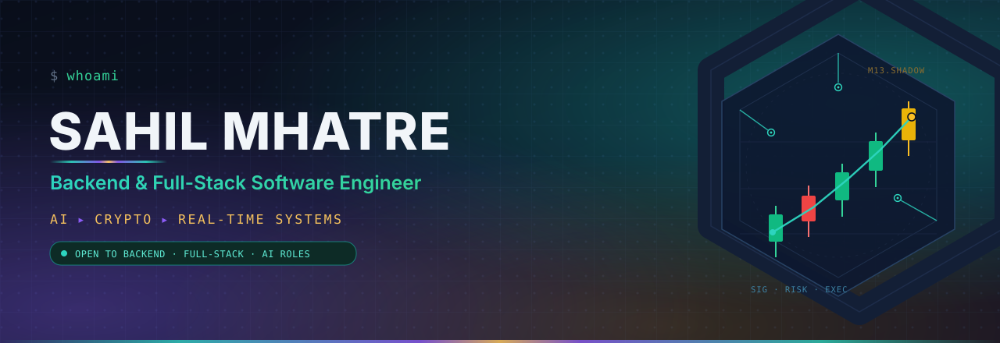
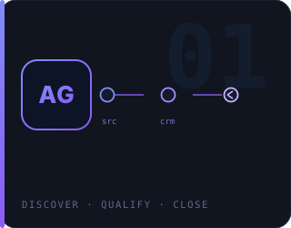
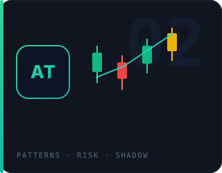
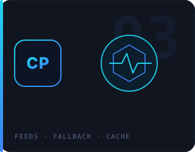
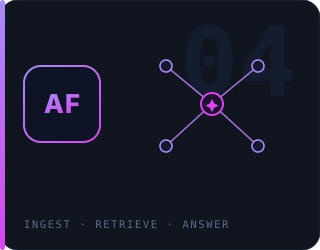
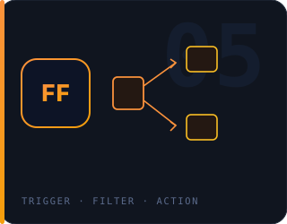
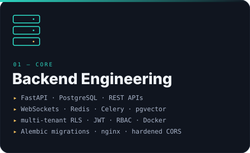
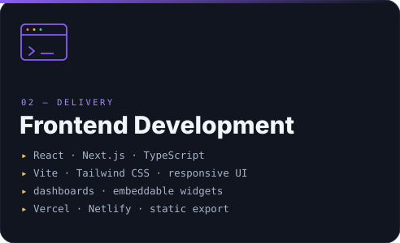
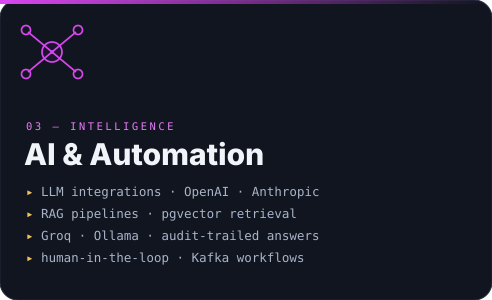
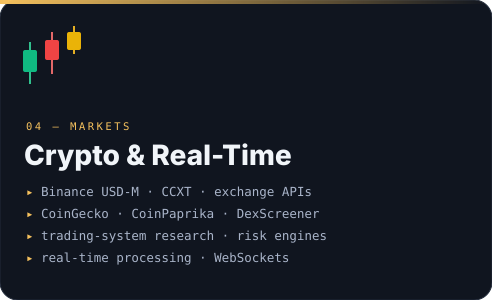

  

  

  
  
  
  

## `//` about

I build scalable backend services, full-stack applications and intelligent systems. My work spans **API development, database architecture, AI-powered applications, cryptocurrency platforms and workflow automation** — a backend-first mindset with the frontend range to ship end-to-end.

`currently building` [Agency Growth Automation Platform](https://github.com/sahilmhatre4796/agency-growth-automation-platform) — AI-powered lead discovery, qualification and outreach automation, in active development.

`strengths` backend architecture · API engineering · database design · real-time systems · RAG pipelines

`fluent in` React/Next.js · LLM integrations (OpenAI · Anthropic · Ollama · Groq) · event-driven architecture

`open to` backend · full-stack · AI engineering roles

## `//` SELECTED PROJECTS | TOP 5

### 01 — [Agency Growth Automation Platform](https://github.com/sahilmhatre4796/agency-growth-automation-platform) <code>IN ACTIVE DEVELOPMENT</code>

AI-powered backend and automation platform for international B2B agency growth — prospect discovery, qualification, enrichment, CRM and personalized outreach.

**Implemented:** multi-tenant org-scoped CRM on Postgres RLS (tested) · bounded campaign orchestration (Serper, credit budgets, row-locked leases, pause/resume/cancel, per-page diagnostics, anti-directory filtering) · evidence-cited qualification with human-in-the-loop routing · opt-in, audit-bound enrichment. **Not live yet:** production deployment pending integration sign-off — live email sending is disabled by default; multi-sender Gmail architecture implemented, no provider connected. 650+ tests · GitHub Actions CI.

`next.js 16 · react 19 · typescript · supabase · vitest`

**[→ View repository](https://github.com/sahilmhatre4796/agency-growth-automation-platform)**

 

### 02 — [Adaptive Crypto Trading System](https://github.com/sahilmhatre4796/adaptive-crypto-trading-system) <code>PAPER / SHADOW ONLY</code>

Python framework for researching adaptive, multi-timeframe crypto strategies. **There is no code path anywhere in this codebase that places, modifies or cancels real orders.**

Public Binance USD-M ingestion → pattern detection → ATR-normalized market structure → multi-timeframe context (4h regime / 1h direction) → signal qualification with replay protection → risk approval (≤10% planned equity loss, `Decimal`) → simulated execution, append-only journals, deterministic replay, crash recovery, read-only dashboard. Live public-data **shadow evaluation** — 52 journaled decisions; strategy edge is **unvalidated** (M11 open). 522 tests, fully offline.

`python 3.13 · pandas · sqlite · binance usd-m`

**[→ View repository](https://github.com/sahilmhatre4796/adaptive-crypto-trading-system)**

 

### 03 — [Crypto Pulse](https://github.com/sahilmhatre4796/cryptopulse-backend/tree/main/cryptopulse-backend/cryptopulse-backend) <code>MARKET INTELLIGENCE</code>

Cryptocurrency market intelligence platform — Express API, PostgreSQL, and a static dashboard with live prices, portfolio tracking and watchlists.

JWT access/refresh auth, bcrypt, helmet, CORS allowlist, rate limiting. Market data with caching and provider fallback: CoinGecko (primary) → CoinPaprika, plus DexScreener DEX pair discovery, Alternative.me Fear &amp; Greed, RSS news aggregation. Portfolio P&amp;L, watchlists, price-alert state machine, AES-256-GCM encrypted exchange-key CRUD. 32 integration tests against real PostgreSQL · frontend on Netlify. Honest scope: exchange integration is key storage only; bots are config/P&amp;L tracking, execution planned.

`node.js · express · postgresql · jwt · netlify`

**[→ View repository](https://github.com/sahilmhatre4796/cryptopulse-backend/tree/main/cryptopulse-backend/cryptopulse-backend)**

 

### 04 — [AI Flow](https://aiflow-ai.vercel.app/) <code>LIVE</code>

AI-powered SaaS for building no-code RAG chatbots — a self-hosted multi-tenant alternative to Intercom-style bot builders.

**Backend** ([ai-flow-backend](https://github.com/sahilmhatre4796/ai-flow-backend)): FastAPI + async PostgreSQL + pgvector · Celery + Redis ingestion · WebSocket chat over Redis pub/sub · 404-not-403 tenant isolation · RBAC (owner/admin/agent/viewer) · swappable providers (OpenAI/Anthropic/Ollama). Full RAG pipeline: PDF/DOCX/CSV/URL → sentence-boundary chunking → embeddings → cosine-distance retrieval → grounded replies with audit trail. **Frontend** ([ai-flow-frontend](https://github.com/sahilmhatre4796/ai-flow-frontend)): Vite + React dashboard — Bot Builder, Knowledge Base, Conversations, Leads, Analytics, Team, Billing — plus embeddable widget. Honest gaps: agent live-conversation WS not yet in dashboard (REST polling); doc-status polls every 3s.

`fastapi · pgvector · redis · celery · react · vite`

**[→ Visit live site](https://aiflow-ai.vercel.app/)** · **[→ Backend](https://github.com/sahilmhatre4796/ai-flow-backend)** · **[→ Frontend](https://github.com/sahilmhatre4796/ai-flow-frontend)**

 

### 05 — [FlowForge](https://github.com/sahilmhatre4796/flowforge) <code>EVENT-DRIVEN · KAFKA</code>

Webhook automation platform (Zapier/n8n/Make-style) — incoming HTTP events become DAG executions across a Kafka backbone.

`/hooks/{slug}` ingest with HMAC-SHA256 signatures · JWT auth (30-min access / 14-day refresh) · Fernet-encrypted API keys · Redis rate limiting · RBAC. Kafka bus: `webhook-events` · `workflow-executions` (retry) · `notifications` · `audit-logs` · `workflow-executions-dlq`, consumer groups scale horizontally. DAG executor: webhook/schedule/manual triggers → filter/if-else/delay/transform → HTTP, Slack, Discord, Telegram, SMTP, allow-listed SQL INSERT. Next.js 15 frontend · Docker Compose: PG 16 + Alembic, Kafka, nginx, Prometheus + Grafana. Honest scope: portfolio-scale build with production-style architecture — not load-proven.

`fastapi · kafka · postgresql · redis · next.js 15 · docker`

**[→ View repository](https://github.com/sahilmhatre4796/flowforge)**

 

## `//` the stack

  
  
   
  
  

<code>languages — python · javascript · typescript · sql</code> <code>also — mongodb · supabase · git · github actions · linux · prometheus · grafana</code>

## `//` github analytics

  

  
  

  

## `//` let's connect

  
  
  

<i>Open to backend, full-stack and AI engineering opportunities — let's build something solid.</i>

